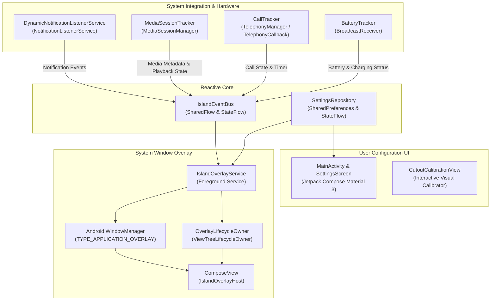

# Dynamic Island for Android 🏝️

[](https://opensource.org/licenses/Apache-2.0)
[](https://developer.android.com)
[](https://kotlinlang.org)
[](https://developer.android.com/jetpack/compose)

A completely new, open-source Android application inspired by Apple's Dynamic Island, engineered from scratch using modern Android development practices, **Jetpack Compose**, **Kotlin Coroutines/StateFlow**, and **native Android APIs**.

---

## ✨ Features

- **Fluid Spring Physics & Morphing Pill**:
  - Seamlessly morphs between **Idle**, **Compact Pill**, **Multi-tasking Split Bubble**, and **Expanded Interactive Card**.
  - Tunable spring stiffness and damping ratio for natural, organic bounce.
  - Haptic feedback integration mimicking Apple's tactile ticks on tap and swipe.
- **Active Music Playback & Audio Visualizer**:
  - Integrates with Android's native `MediaSessionManager` and `MediaController`.
  - Works with Spotify, YouTube Music, Apple Music, SoundCloud, Podcasts, and system players.
  - Displays high-resolution album art, track title, artist name, and interactive progress scrubber.
  - Real-time animated audio equalizer waveform reflecting live playback state.
- **Live Notifications & Heads-Up Alerts**:
  - Non-intrusive notification previews powered by `NotificationListenerService`.
  - App badges, sender identity, and message snippets.
  - Interactive action buttons (Reply, Mark as Read, Dismiss, Open App).
  - Intelligent spam filtering: suppresses background ongoing system notifications.
- **Incoming & In-Call Indicators**:
  - Detects phone calls across both standard carrier calls and VoIP services.
  - Green telephone indicator in compact state with running duration timer (`MM:SS`).
  - Expanded card with caller name, caller number, decline button, and answer controls.
- **Battery & Charging Status**:
  - Real-time charging animation displaying battery level and charging technology (*Fast Charging*, *Super Fast Charging*, *Wireless Charging*).
  - Low battery alerts with subtle color warnings.
- **Multi-tasking Split Island**:
  - When two simultaneous activities are active (e.g., Music playing while phone is charging), the island splits into a primary pill and a detached auxiliary circular bubble.
- **Interactive Screen Cutout Calibrator**:
  - Live visual calibration tool with sliders for X-offset, Y-offset, compact width, compact height, and corner radius.
  - Hardware cutout adaptation presets: **Center Punch Hole**, **Left Punch Hole**, **Right Punch Hole**, **Waterdrop Notch**, and **Custom Offset**.
- **AMOLED & Frosted Glass Themes**:
  - **AMOLED Pure Black** for zero battery consumption on OLED displays.
  - **Frosted Glass Blur** with translucent subtle border glow.
  - **Ambient Accent** adapting to album art and notification themes.

---

## 🏛️ Architecture Overview

The app follows Clean Architecture principles and separates concerns into presentation, domain event dispatch, background services, and hardware abstraction.



---

## 📁 Project Structure

```
├── app/
│   ├── build.gradle.kts                # App-level dependencies & Compose configuration
│   ├── proguard-rules.pro              # Proguard optimization rules
│   └── src/
│       ├── main/
│       │   ├── AndroidManifest.xml     # Permissions, foreground services, activities
│       │   ├── java/com/dynamicisland/android/
│       │   │   ├── DynamicIslandApp.kt # Application class & notification channels
│       │   │   ├── data/
│       │   │   │   └── SettingsRepository.kt       # Persistent settings with StateFlow
│       │   │   ├── model/
│       │   │   │   ├── BatteryInfo.kt              # Battery and charging data model
│       │   │   │   ├── CallInfo.kt                 # Telephony state and timer model
│       │   │   │   ├── IslandEvent.kt              # Event bus sealed class
│       │   │   │   ├── IslandSettings.kt           # Positioning and customization models
│       │   │   │   ├── IslandState.kt              # Visual state machine
│       │   │   │   ├── MediaInfo.kt                # Music metadata and progress model
│       │   │   │   └── NotificationItem.kt         # Notification model with action intents
│       │   │   ├── service/
│       │   │   │   ├── BatteryTracker.kt           # Battery state monitor
│       │   │   │   ├── BootReceiver.kt             # Auto-start on boot receiver
│       │   │   │   ├── CallTracker.kt              # Telephony state monitor
│       │   │   │   ├── DynamicNotificationListenerService.kt # Notification listener
│       │   │   │   ├── IslandEventBus.kt           # Reactive event bus singleton
│       │   │   │   ├── IslandOverlayService.kt     # Master foreground overlay service
│       │   │   │   ├── MediaSessionTracker.kt      # Media controller and playback manager
│       │   │   │   └── OverlayLifecycleOwner.kt    # Lifecycle owner for overlay ComposeView
│       │   │   ├── ui/
│       │   │   │   ├── overlay/
│       │   │   │   │   ├── AudioWaveformVisualizer.kt # Animated sound equalizer bars
│       │   │   │   │   ├── CompactIslandContent.kt    # Compact pill content
│       │   │   │   │   ├── ExpandedIslandContent.kt   # Interactive expanded cards
│       │   │   │   │   ├── IslandOverlayHost.kt       # Root overlay container
│       │   │   │   │   ├── IslandPillContainer.kt     # Spring physics and morphing logic
│       │   │   │   │   └── SplitBubbleContent.kt      # Multitasking secondary bubble
│       │   │   │   ├── settings/
│       │   │   │   │   ├── CutoutCalibrationView.kt   # Screen alignment calibrator
│       │   │   │   │   ├── MainActivity.kt            # Settings activity
│       │   │   │   │   ├── PermissionHelper.kt        # System permission checkers
│       │   │   │   │   └── SettingsScreen.kt          # Material 3 configuration screen
│       │   │   │   └── theme/
│       │   │   │       ├── Color.kt
│       │   │   │       ├── Theme.kt
│       │   │   │       └── Type.kt
│       │   │   └── util/
│       │   │       ├── AnimationSpecs.kt              # Spring curves and damping ratios
│       │   │       ├── DisplayCutoutHelper.kt         # Android DisplayCutout parser
│       │   │       └── WindowUtils.kt                 # WindowManager.LayoutParams utilities
│       │   └── res/                                   # Drawables, themes, and layouts
│       └── test/                                      # Unit tests for state machine & models
├── gradle/
│   ├── libs.versions.toml             # Gradle Version Catalog
│   └── wrapper/                       # Gradle wrapper configuration
├── build.gradle.kts                   # Root build configuration
├── settings.gradle.kts                # Project structure & repositories
├── gradlew                            # Gradle wrapper POSIX script
├── gradlew.bat                        # Gradle wrapper Windows script
├── BUILD.md                           # Comprehensive compilation manual
├── CONTRIBUTING.md                    # Open-source contribution guidelines
└── LICENSE                            # Apache 2.0 License
```

---

## 🚀 Getting Started

### Requirements
- **JDK 17 or JDK 21**
- **Android SDK Platform 35 (Android 15)**
- **Android Studio Koala / Ladybug or Gradle 8.7+**

### Step-by-Step Compilation

1. **Clone the repository**:
   ```bash
   git clone https://github.com/your-username/dynamic-island-android.git
   cd dynamic-island-android
   ```

2. **Build the Debug APK**:
   ```bash
   ./gradlew assembleDebug
   ```

3. **Install on connected device via ADB**:
   ```bash
   adb install -r app/build/outputs/apk/debug/app-debug.apk
   ```

For detailed compilation steps and release signing instructions, consult [BUILD.md](BUILD.md).

---

## 🔒 Permissions & Privacy

Dynamic Island operates strictly on-device without any internet or analytics tracking:

| Permission | Purpose |
|:---|:---|
| `SYSTEM_ALERT_WINDOW` | Allows floating the pill above applications and the status bar. |
| `BIND_NOTIFICATION_LISTENER_SERVICE` | Intercepts media playback and notifications to render previews. |
| `READ_PHONE_STATE` | Detects incoming and active calls to show caller info and call duration. |
| `FOREGROUND_SERVICE` | Keeps the overlay alive and responsive in the background. |
| `RECEIVE_BOOT_COMPLETED` | Automatically restarts the island when the device boots (optional). |
| `VIBRATE` | Provides subtle haptic feedback when interacting with the pill. |

---

## ⚡ Performance & Battery Optimization

- **Zero Idle CPU Consumption**: When no audio is playing and no notification banner is active, the overlay enters a dormant idle state without active redraw loops.
- **Dynamic Touch Window Sizing**: The `WindowManager.LayoutParams` bounding box automatically shrinks to the compact pill size when collapsed, allowing touches outside the island to pass through seamlessly to foreground apps.
- **Downsampled Image Processing**: Large notification and album art drawables are safely scaled to thumbnail resolutions to maintain low memory overhead.

---

## 📄 License

This project is licensed under the **Apache License 2.0**. See the [LICENSE](LICENSE) file for complete details.
# Andorind-dynamic-island
