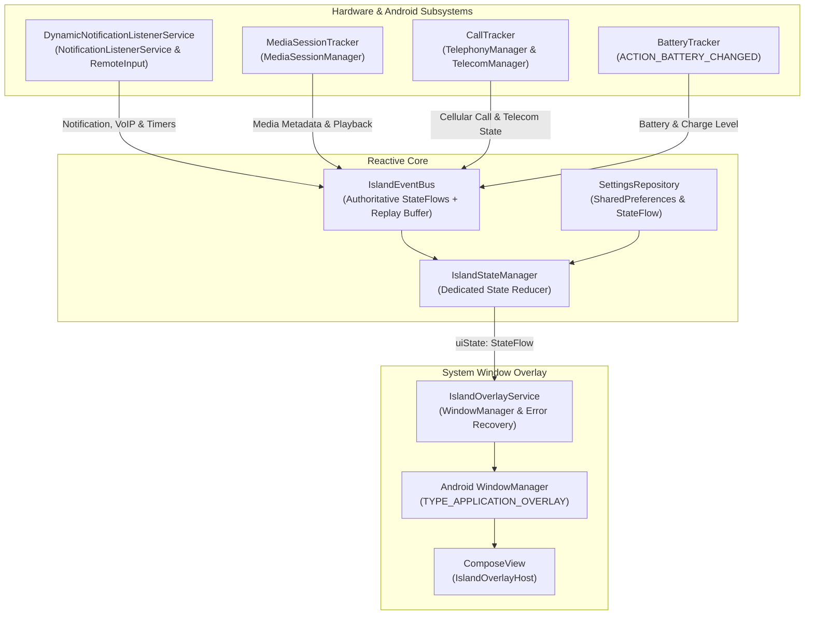

# Dynamic Island for Android 🏝️

[](https://opensource.org/licenses/Apache-2.0)
[](https://developer.android.com)
[](https://kotlinlang.org)
[](https://developer.android.com/jetpack/compose)

A completely new, open-source Android application inspired by Apple's Dynamic Island, engineered from scratch using modern Android development practices: **Jetpack Compose** (running directly inside a native `WindowManager` overlay), **Kotlin Coroutines & StateFlow**, a dedicated **State Reducer architecture**, and **Android system APIs**.

---

## ✨ Features & Implementation Details

- **Fluid Spring Physics & Morphing Pill**:
  - Seamlessly morphs between **Idle**, **Compact Pill**, **Multi-tasking Split Bubble**, and **Expanded Interactive Card**.
  - Tunable spring stiffness and damping ratio (`Spring.StiffnessMediumLow`, `Spring.DampingRatioLowBouncy`) for organic bounce.
  - Haptic feedback integration mimicking tactile clicks on tap, expand, and swipe gestures.
- **Active Music Playback & Audio Visualizer**:
  - Integrates with Android's native `MediaSessionManager` and `MediaController`.
  - Discovers active sessions across Spotify, YouTube Music, Apple Music, SoundCloud, and podcast players.
  - Displays high-resolution album art, track title, artist name, and an interactive progress scrubber.
  - Real-time animated audio equalizer waveform reflecting live playback state.
- **Live Notifications with RemoteInput Direct Reply**:
  - Non-intrusive notification previews powered by `DynamicNotificationListenerService`.
  - **Inline Direct Reply**: Type responses directly in the expanded island card using Android `RemoteInput` without leaving your current app.
  - **System Notification Dismissal**: Tapping "Dismiss" cancels the notification in the Android system notification tray via `cancelNotification(key)`.
  - **Targeted Ongoing Filtering**: Retains critical ongoing updates (calls, timers, navigation, ride sharing) while suppressing silent system noise.
  - **Memory Protection**: Bitmaps and notification icons are scaled and clamped (max 128x128) to prevent OutOfMemory issues on low-RAM devices (e.g. Samsung Galaxy A35).
  - **Lock Screen Privacy**: Automatically redacts private message content when `KeyguardManager` reports the device is locked.
- **Incoming & In-Call Indicators**:
  - **VoIP Call Support**: Intercepts `Notification.CATEGORY_CALL` from WhatsApp, Telegram, Google Meet, and phone dialers, extracting caller name, avatar, and native Answer/Decline `PendingIntent`s.
  - **Cellular Call Management**: Uses `TelephonyManager` / `TelephonyCallback` to monitor call states and duration, and `TelecomManager` (`acceptRingingCall()`, `endCall()`) on Android 9+ (API 28+) when `ANSWER_PHONE_CALLS` is granted.
- **Active Timer & Clock Integration**:
  - Tracks running timers and stopwatches from system Clock applications (Google Clock, Samsung Clock).
  - Expanded timer card features actionable Pause and Resume buttons backed by the clock application's intents.
- **Battery & Charging Status**:
  - Real-time charging animation displaying battery level and charging technology (*Fast Charging*, *Super Fast Charging*, *Wireless Charging*).
  - Low battery alerts with subtle color warnings.
- **Multi-tasking Split Island**:
  - When two simultaneous activities are active (e.g., Music playing while phone is charging or a timer is running), the island splits into a primary pill and an auxiliary detached circular bubble.
- **Interactive Screen Cutout Calibrator**:
  - Live visual calibration tool with sliders for X-offset, Y-offset, compact width, compact height, and corner radius.
  - Cutout presets: **Center Punch Hole**, **Left Punch Hole**, **Right Punch Hole**, **Waterdrop Notch**, and **Custom**.

---

## 🏛️ Architecture & Reducer Pattern

To prevent god-service anti-patterns, the architecture cleanly separates concerns into:
1. **`IslandStateManager`**: Pure state reducer and state-holder responsible for event prioritization (Incoming Calls > In-Call > Timers > Toasts > Split Multi-tasking > Media > Idle).
2. **`IslandEventBus`**: Authoritative `StateFlow` repository for persistent states (Battery, Media, Calls, Timers, Notifications) paired with a replay-buffered `SharedFlow` for transient gestures. Eliminates event loss regardless of collector startup timing.
3. **`IslandOverlayService`**: Lightweight Android Foreground Service strictly managing `WindowManager` lifecycle, dynamic layout params updating, and `ComposeView` hosting.



---

## 🔒 Permissions & Android API Requirements

| Permission | Purpose | Notes |
|:---|:---|:---|
| `SYSTEM_ALERT_WINDOW` | Floats the island over system UI and apps. | Required on first launch. |
| `BIND_NOTIFICATION_LISTENER_SERVICE` | Reads music metadata, notifications, and VoIP call actions. | Granted via System Notification Access. |
| `READ_PHONE_STATE` | Monitors incoming cellular call status and call duration. | Standard runtime permission. |
| `ANSWER_PHONE_CALLS` | Enables answering and ending cellular calls via `TelecomManager`. | Android 9+ (API 28+). Optional. |
| `READ_CONTACTS` | Resolves caller name from phone number for cellular calls. | Optional. |
| `FOREGROUND_SERVICE` | Keeps overlay responsive in the background. | Android standard foreground service. |
| `VIBRATE` | Provides subtle haptic feedback when interacting with the pill. | |

> **Note on Call Answering**: Answering VoIP calls (WhatsApp, Telegram) is handled via the app's native notification `PendingIntent`. Cellular call control requires Android 9+ and `android.permission.ANSWER_PHONE_CALLS`.

---

## ⚡ Performance, Memory, and Device Compatibility

- **Zero Idle CPU**: When no audio is playing and no alert is active, the overlay enters a dormant idle state without active redraw loops.
- **Dynamic Touch Window Sizing**: The `WindowManager.LayoutParams` bounding box automatically shrinks to the compact pill size when collapsed, allowing touches outside the island to pass through seamlessly to foreground apps.
- **Clamped Image Allocation**: All notification icons and album arts are scaled down to 128x128 pixels to protect against OutOfMemory exceptions on budget and mid-range devices (e.g., Samsung Galaxy A-series).
- **Tested Device Formats**: Center punch-hole (Pixel, Galaxy S/A series), Left punch-hole (OnePlus, Xiaomi), Right punch-hole (Galaxy S10), and waterdrop notches.

---

## 🚀 Build & Compilation

### Requirements
- **JDK 17 or JDK 21**
- **Android SDK Platform 35 (Android 15)**
- **Android Studio Koala / Ladybug or Gradle 8.7+**

### Command Line
```bash
# Run unit tests
./gradlew test

# Build Debug APK
./gradlew assembleDebug

# Output APK:
# app/build/outputs/apk/debug/app-debug.apk

# Install via ADB:
adb install -r app/build/outputs/apk/debug/app-debug.apk
```

Consult [BUILD.md](BUILD.md) for full setup instructions and release signing steps.

---

## 📄 License

Licensed under the **Apache License 2.0**. See the [LICENSE](LICENSE) file for complete details.
