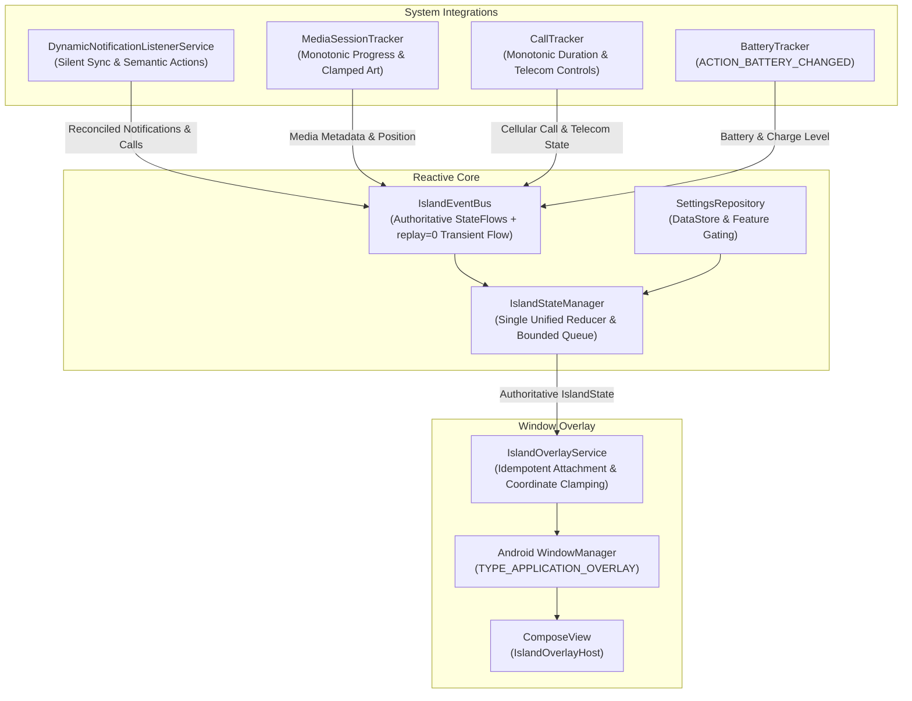

# Dynamic Island for Android 🏝️

[](https://opensource.org/licenses/Apache-2.0)
[](https://developer.android.com)
[](https://kotlinlang.org)
[](https://developer.android.com/jetpack/compose)

A completely new, open-source Android application inspired by Apple's Dynamic Island, engineered from scratch using modern Android development practices: **Jetpack Compose** (running directly inside a native `WindowManager` overlay), **Kotlin Coroutines & StateFlow**, an authoritative **Single Reducer Architecture**, and **Android native system APIs**.

---

## ✨ Features & Architecture Highlights

- **Fluid Spring Physics & Morphing Pill**:
  - Seamlessly morphs between **Idle**, **Compact Pill**, **Multi-tasking Split Bubble**, and **Expanded Interactive Card**.
  - Tunable spring stiffness and damping ratio (`Spring.StiffnessMediumLow`, `Spring.DampingRatioLowBouncy`) for organic bounce.
  - Haptic feedback integration mimicking tactile clicks on tap, expand, and swipe gestures.
- **Active Music Playback & Audio Visualizer**:
  - Integrates with Android's native `MediaSessionManager` and `MediaController`.
  - Discovers active sessions across Spotify, YouTube Music, Apple Music, SoundCloud, and podcast players.
  - Smooth monotonic progress calculation and periodic ticker preventing progress bar freezing.
  - Clamped album art (max 256x256) preventing OutOfMemory on budget devices.
  - Real-time animated audio equalizer waveform reflecting live playback state.
- **Live Notifications with RemoteInput Direct Reply**:
  - Non-intrusive notification previews powered by `DynamicNotificationListenerService`.
  - **Silent Startup Synchronization**: Reconciles active notifications on service connection without alert toast spam.
  - **Inline Direct Reply**: Type responses directly in the expanded island card using Android `RemoteInput` without leaving your current app.
  - **System Notification Dismissal**: Tapping "Dismiss" cancels the notification in the Android system notification tray via `cancelNotification(key)`.
  - **Targeted Ongoing Filtering**: Retains critical ongoing updates (calls, timers, navigation) while suppressing silent system noise.
  - **Lock Screen Privacy**: Automatically redacts private message content when `KeyguardManager` reports the device is locked.
- **Incoming & In-Call Indicators**:
  - **Multi-Source Call Handling**: Keeps cellular telephony calls and third-party VoIP calls (WhatsApp, Telegram) distinct. VoIP notification dismissals will never inadvertently clear an active cellular call.
  - **Monotonic Duration Counter**: Ties call duration to `SystemClock.elapsedRealtime()` to prevent resets from background re-renders.
  - **Contact Preservation**: Retains caller identity across modern Android 12+ (API 31+) callbacks where telephony state changes pass null phone numbers.
  - **Cellular Call Management**: Uses `TelecomManager` (`acceptRingingCall()`, `endCall()`) on Android 9+ (API 28+) when `ANSWER_PHONE_CALLS` is granted, with error surfacing.
- **Active Timer & Clock Integration**:
  - Tracks running timers and stopwatches from system Clock applications.
  - Multi-format parser supports `HH:MM:SS`, `MM:SS`, and `Xs` formats without synthetic fallbacks.
  - Actionable **Pause**, **Resume**, and **Reset/Cancel** controls backed by native intents.
- **Battery & Charging Status**:
  - Verified charging labels (`Charging (AC)`, `Charging (USB)`, `Wireless Charging`) based on hardware status.
  - Low battery alert (<= 20%) with hysteresis resetting only after recharging above 25% or connecting to power.
  - Explicit unknown battery level modeling (`--%`).
- **Multi-tasking Split Island**:
  - When two simultaneous activities are active (e.g., Music playing while phone is charging or a timer is running), the island splits into a primary pill and an auxiliary detached circular bubble.
- **Hardware Cutout & Display Calibrator**:
  - Reads physical camera cutout bounds via `DisplayCutout` on Android 9+.
  - Interactive calibrator for fine-tuning offsets relative to real camera punch-hole locations.
  - Display bounds clamping preventing off-screen positioning when `FLAG_LAYOUT_NO_LIMITS` is active.

---

## 🏛️ Authoritative Reducer Architecture

To guarantee state consistency and prevent race conditions between independently running Android subsystems, state coordination is unified in `IslandStateManager`:

```
1. Incoming Ringing Call   (Highest priority - never miss a call)
2. Active In-Call Session  (Cellular or VoIP)
3. User-Expanded Content   (User-selected card remains open until dismissed)
4. Active Running Timer    (Countdown or Stopwatch)
5. Transient Alert Toast   (Bounded FIFO queue of max 5 items with unique timeouts)
6. Multi-tasking Split     (Active Media + Battery Charging / Timer)
7. Active Music Playback   (Foreground playback)
8. Idle Pill               (Camera cutout cover)
```



---

## 🔒 Permissions & Android API Requirements

| Permission | Purpose | Notes |
|:---|:---|:---|
| `SYSTEM_ALERT_WINDOW` | Floats the island over system UI and apps. | Required on first launch. |
| `BIND_NOTIFICATION_LISTENER_SERVICE` | Reads music metadata, notifications, and VoIP call actions. | Granted via System Notification Access. |
| `READ_PHONE_STATE` | Monitors incoming cellular call status and call duration. | Standard runtime permission. |
| `ANSWER_PHONE_CALLS` | Enables answering and ending cellular calls via `TelecomManager`. | Android 9+ (API 28+). Optional. |
| `READ_CONTACTS` | Resolves caller name from phone number for cellular calls. | Optional. |
| `FOREGROUND_SERVICE` | Keeps overlay responsive in the background. | Android standard foreground service. |
| `VIBRATE` | Provides subtle haptic feedback when interacting with the pill. | Optional. |

---

## ⚡ Performance, Memory, and Battery Targets

- **Negligible Idle Overhead**: When no audio is playing and no alert is active, the overlay enters a dormant idle state without active composition loops or unnecessary background redraws.
- **Dynamic Touch Window Sizing**: The `WindowManager.LayoutParams` bounding box automatically shrinks to the compact pill size when collapsed, allowing touches outside the island to pass through seamlessly to foreground apps.
- **Clamped Image Allocation**: All notification icons and album arts are scaled down (max 128x128 for icons, 256x256 for album art) to prevent OutOfMemory exceptions on budget and mid-range devices (e.g., Samsung Galaxy A-series).
- **Subsystem Resource Release**: Disabling the island in settings halts background trackers and transitions the Compose lifecycle to `ON_PAUSE`.

---

## 🚀 Build & Installation

### Requirements
- **JDK 17 or JDK 21**
- **Android SDK Platform 35 (Android 15)**
- **Android Studio Koala / Ladybug or Gradle 8.7+**

### Command Line
```bash
# Clone the repository
git clone https://github.com/louicastro/Android-dynamic-island.git
cd Android-dynamic-island

# Run unit tests
./gradlew test

# Build Debug APK
./gradlew assembleDebug

# Output APK:
# app/build/outputs/apk/debug/app-debug.apk

# Install via ADB:
adb install -r app/build/outputs/apk/debug/app-debug.apk
```

Consult [BUILD.md](BUILD.md) for full setup instructions, R8 configuration, and release signing steps.

---

## 📄 License

Licensed under the **Apache License 2.0**. See the [LICENSE](LICENSE) file for complete details.
